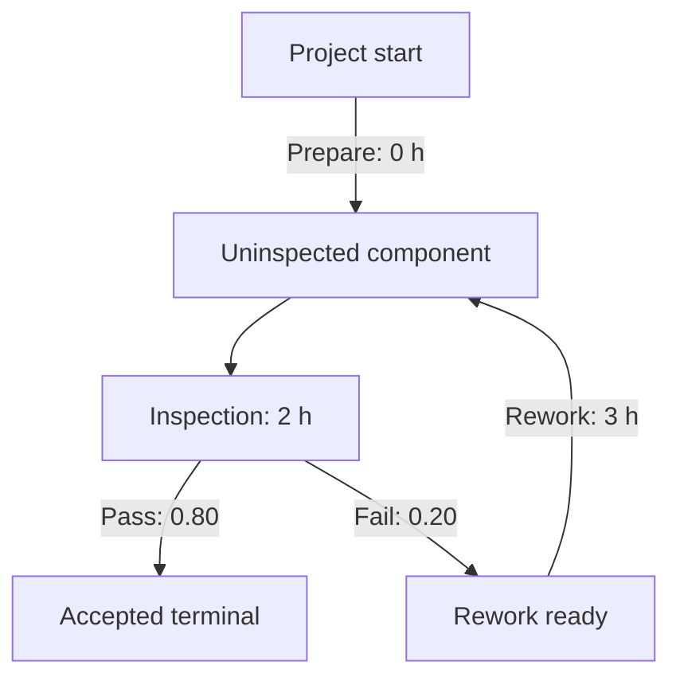

# GERT Studio tutorial

Review draft • GERT Studio 0.2.0 Windows preview • updated 19 October 2026

Build a quality-control process, add uncertainty and rework, simulate it, and save the network. Then extend the same ideas to parallel work and synchronization. No prior GERT knowledge is required.

This guide follows the mathematical specification and editor at GitHub `main` commit `52fcd732787d5829d923bf2178594de21704b2dc` (2 October 2026), inspected on 19 October 2026. The published Windows preview is tag `v0.2.0`, built from application source `e4d0b26b281803a520c0525fa8f62011b55219f2`; the later main commit adds the Windows build workflow. The numeric values below are deliberate examples you enter yourself, not application defaults. Use one consistent time unit throughout; we will use hours.

## What changed since the previous tutorial

| Now available | Where to learn it |
| --- | --- |
| Published Windows 0.2.0 preview ZIP | Installation, Lesson 0A |
| Node, duration, and outcome documentation with descriptive certainty | Lesson 15 |
| Importable null placeholders and separate draft/readiness validation | Lessons 4 and 16 |
| Export/import of saved simulation results and settings | Lesson 4 |
| P5–P95 percentiles, spread, Monte Carlo SE, and method-specific 95% confidence intervals | Lesson 8 |
| Resizable panels and saved panel-size preferences | Lesson 12 |
| Engine 0.1.1 and controlled cross-platform Beta-PERT numerics | Lesson 9 |
| GitHub Actions portable build | Lesson 0E |

The interface release is 0.2.0; the model schema remains 0.1, and the simulation engine is 0.1.1. Those are separate version numbers. Positive consumable requirements are still mandatory. Deterministic minimum completion time, critical-path analysis, Monte Carlo criticality, and reusable capacity scheduling are not implemented in the baseline simulator. Do not infer availability from a proposal or another local branch.

## Learning route

| Part | Goal |
| --- | --- |
| 0 | Install and verify the application |
| 1–3 | Build and simulate a deterministic inspection |
| 4 | Export and import your network |
| 5–7 | Add pass/fail outcomes, uncertain durations, and a rework loop |
| 8–9 | Interpret results and reproduce runs |
| 10–11 | Model parallel instances and synchronization |
| 12–14 | Use editing tools, troubleshoot, and explore a complete prototype example |
| 15–17 | Write documentation, preserve unknowns, and use the interactive guide |

## 0. Get GERT Studio

Repository: [gyudar103/gert-studio](https://github.com/gyudar103/gert-studio).

Choose one route. Ordinary Windows users use a packaged application when one is supplied. Developers can run Docker or run the Python backend and JavaScript frontend locally.

### 0A. Windows portable application — recommended for Windows users

1. Open the [GERT Studio 0.2.0 Windows preview release](https://github.com/gyudar103/gert-studio/releases/tag/v0.2.0).
2. Under **Assets**, download **GERT-Studio-Windows.zip**. GitHub's automatically generated Source code ZIP is not the application.
3. Extract the entire application ZIP to a folder.
4. Double-click **GERT Studio.exe** and keep the control window open.
5. Your default browser should open the editor. If it does not, use **Open GERT Studio** in the control window or copy its displayed local address. Use the displayed port; it need not be 5173.

No separate Python, Node.js, npm, Git, Docker, WSL, or developer tools are needed. Keep `_internal` beside the EXE and run from the extracted folder, not from inside the ZIP. The application can work offline in your installed browser.

This is a published **unsigned prerelease**, not a final signed release. Its release notes report native Windows tests, but leave fresh-machine/standard-user and browser/security-software checks as manual acceptance items. This tutorial does not claim to have rerun those checks.

To check download integrity, obtain the accompanying `GERT-Studio-Windows.zip.sha256` asset. In PowerShell, run `Get-FileHash .\GERT-Studio-Windows.zip -Algorithm SHA256` and compare the hash with that asset. A matching checksum verifies bytes against the published checksum; it is not a code signature.

Export your model or results before exiting. Click **Exit GERT Studio** in the control window to stop the server; closing the browser tab alone does not stop it. Each browser tab has its own editor state. Startup logs are at `%LOCALAPPDATA%\GERT Studio\launcher.log`.

For developer packaging instructions, see [WINDOWS_DISTRIBUTION.md](https://github.com/gyudar103/gert-studio/blob/52fcd732787d5829d923bf2178594de21704b2dc/docs/WINDOWS_DISTRIBUTION.md). Docker is an optional route, not a prerequisite for the portable app.

### 0B. Developers: optional Docker

Install Git and Docker with a running Linux container engine. On Windows or macOS, start Docker Desktop. Open PowerShell on Windows or Terminal on macOS/Linux:

```sh
git clone https://github.com/gyudar103/gert-studio.git
cd gert-studio
docker compose up --build -d
```

The first build needs internet access to obtain images and dependencies. Docker installs the backend and frontend dependencies; host Python and Node are unnecessary.

Open [http://localhost:5173](http://localhost:5173). Check the services with:

```sh
docker compose ps
```

[http://localhost:8000/api/health](http://localhost:8000/api/health) should show `{"status":"ok"}`.

If you already downloaded the repository source ZIP, extract it and open a terminal in the folder containing `docker-compose.yml`. Start with `docker compose up --build -d`; cloning and Git are unnecessary for simply running that copy.

To inspect startup failures:

```sh
docker compose logs --tail=100 backend frontend
```

To stop the application after exporting your work:

```sh
docker compose down
```

### 0C. Developers: Python and Node without Docker

Use Python 3.12 and Node.js 22. Python runs the API; Node/npm runs the frontend. Python alone is insufficient for the complete editor.

Clone the repository as above. In the first terminal, from the repository root:

**Windows PowerShell**

```powershell
cd backend
py -3.12 -m venv .venv
.\.venv\Scripts\python.exe -m pip install -r requirements.txt
.\.venv\Scripts\python.exe -m uvicorn app.main:app --host 127.0.0.1 --port 8000 --reload
```

**macOS/Linux**

```sh
cd backend
python3.12 -m venv .venv
.venv/bin/python -m pip install -r requirements.txt
.venv/bin/python -m uvicorn app.main:app --host 127.0.0.1 --port 8000 --reload
```

Open a second terminal at the repository root:

```sh
cd frontend
npm ci
npm run dev -- --host 127.0.0.1
```

Open [http://localhost:5173](http://localhost:5173). The frontend proxies `/api` to the backend on port 8000. Leave both terminals running. To stop, export your work and press Ctrl+C in both terminals.

Native Python 3.12 and Node/npm are the current primary developer tools; Docker remains optional. These commands are derived from the repository configuration, not fresh clean-install testing on all three operating systems.

### 0D. Verify the editor

Click **Load demo**, then **Validate**, then **Run Simulation**. Loading the demo supplies example settings. You should see a network, a validation report, and simulation results. Warnings deserve attention but do not necessarily mean the model is invalid.

After this check, click **New blank** to begin the tutorial. Confirm replacement when prompted.

> Application capture: [tutorial workspace](tutorial-screenshots/tutorial-desktop.png).

### 0E. Build the portable app using GitHub online

For maintainers with workflow permissions, the repository now has **Actions → Windows portable release**. Select **Run workflow** and wait for the run to finish successfully. Open the run and download the `windows-portable-<source SHA>` artifact, which contains the application ZIP and checksum. Extract the downloaded artifact container, then extract `GERT-Studio-Windows.zip` before launching the EXE.

A manual run checks out **main**, even if another workflow ref is selected. It creates a downloadable build artifact; it does not automatically publish a new Release. The workflow also runs when a GitHub Release is published and attaches built outputs to that Release. It does not run on every push. Release-triggered source must belong to main. Building successfully is not the same as passing clean-machine acceptance; read the run summary and verification requirements.

Ordinary users should download the existing release asset in 0A and do not need to build anything.

## 1. Understand the building blocks

| Concept | Meaning |
| --- | --- |
| Start node | The one node holding initial inventory at time zero |
| State node | A place where produced items accumulate and enable further work |
| Terminal node | A modeled project outcome that ends the realization when reached |
| Item | A named, quantified consumable flow input or output |
| Activity | Consumes required items at one source and takes time |
| Outcome | One alternative selected when an activity completes; produces items at its target |
| Realization | One simulated execution of the entire network |

Activities appear as connections with outcome branches. A multi-outcome activity is one activity, not several competing activities.

There is no single token that must occupy one node. Different activities can execute simultaneously. Items are consumed at activity start and outputs arrive at completion. They are not reusable machine or staffing capacity.

**Two rules shape our example:** Start cannot receive incoming outcomes, and reaching a Terminal ends the whole realization. We therefore start with **one component per realization**. Later we study multiple components separately.

### 1.1 What “consumable” means

A consumable item is a **quantity available for an activity to use**. It can represent physical material, a component, a work request, or evidence that a prerequisite has been satisfied. “Consumed” means removed from the source node's inventory when an activity starts; it does not necessarily mean physically destroyed.

For example, Inspection consumes one `component` at Uninspected component. That component is now being inspected, so another activity cannot use the same inventory unit. On completion, the selected outcome produces a component at Accepted or Rework ready. The model represents the item's movement or change of state through explicit consumption and production.

Think of each node as a local inventory and each activity as a recipe: **what must be available, how much is used, how long the work takes, and what one selected outcome produces**.

| Modeling purpose | Example requirements per instance | Example production | What it expresses |
| --- | --- | --- | --- |
| Move a component | component: 1 | component: 1 at a later node | Work transforms or transfers its state |
| Use raw material | steel_kg: 2.5 | part: 1 | A recipe converts measured material into a part |
| Consume a test sample | sample: 1 | test_report: 1 | A destructive test leaves a report rather than returning the sample |
| Trigger a work package | design_request: 1 | drawing_package: 1 | A request permits one execution |
| Synchronize prerequisites | mechanical_module: 1 AND software_build: 1 | prototype: 1 | Both outputs must have arrived at one source |
| Route a choice | choice_token: 1 | route_a_request: 1 OR route_b_request: 1 | One selected probabilistic outcome enables one route |
| Request rework | repair_request: 1 | component: 1 at inspection buffer | Repair enables another inspection |

A single outcome can produce several item types at its single target. For instance, Build may produce `prototype: 1` and `test_request: 1` at Test ready; Test consumes both. Distinct outcomes are alternatives: producing one item in each of two outcomes does **not** produce both together.

### 1.2 Quantities determine how much work can start

Suppose a source holds Component `5`, and Inspection requires Component `2` per instance. Two instances start together, consuming `4`; Component `1` remains. A third cannot start until enough additional inventory arrives. GERT does not automatically queue the five components through a single inspector.

With multiple requirements, the scarcest input determines the maximum count. If Assembly requires Bolt `2` and Plate `1`, and its source contains Bolt `7` and Plate `2`, it can start `min(floor(7/2), floor(2/1)) = 2` instances. It consumes Bolt `4` and Plate `2`, leaving Bolt `3` and Plate `0`.

This calculation describes one activity in isolation. With several enabled activities sharing inventory, GERT checks their combined maximum demand. It reports resource competition ambiguity when that demand cannot be satisfied; it does not select an allocation automatically.

### 1.3 Items can represent logical prerequisites

An `approval_document` can mean “approval is available to authorize this next step.” Consuming it permits one execution. If two independent downstream tasks should both follow approval, explicitly design a handoff activity that consumes approval and produces two distinct request items at a shared node. Each task consumes its own request. Making both tasks require the same one approval item would create competition.

Similarly, a request token can prevent uncontrolled repetition. A zero-duration routing activity still requires a positive consumable input. If each execution consumes one request and nothing recreates it, it cannot execute endlessly without new input. A loop that recreates its request can repeat, so finite simulation limits remain important.

### 1.4 Inventory is local, and units are your responsibility

If Integration needs one mechanical module and one software build, those items must be at Integration's source node. A module at node A and a build at node B cannot be consumed together merely because both appear in the graph.

Quantities can be fractional and use exact decimal comparisons. With Steel `5.0` kg and a requirement of `2.5` kg, two instances are possible. With `4.999` kg, only one is possible. The engine does not round the shortage away.

Declare item types with clear units, such as `steel_kg`, and keep quantities consistent. Unit conversion is not automatic. Inventory and production are numbers in the model, not physical conservation laws enforced by the engine: you must justify your recipes, yields, losses, and any production of multiple outputs.

### 1.5 Flow items versus reusable capacity

A machine, engineer, or laboratory slot is normally a reusable capacity resource: reserved while work runs, then released. The current flow model uses consumable items. Declaring Machine `1` as an input consumes it; the application does not automatically reserve and return a machine or schedule a capacity queue.

Returning a token through an outcome can represent an explicit flow protocol in some models, but it does not add built-in staffing, calendars, priorities, queues, or machine scheduling. Document that assumption carefully and inspect competition. For the tutorial, use components, requests, and produced deliverables as items.

**Exercises:** (a) Given Bolt `9` and Plate `3`, with requirements Bolt `2` and Plate `1`, predict the maximum starts and leftovers. Answer: 3 starts; Bolt `3`, Plate `0`. (b) Give two activities the same single request and explain why they compete. (c) Redesign that request as a routing choice or two independent requests according to what the process actually means.


## 2. Build the first inspection network

### 2.1 Name the project and create an item

In **Model**, enter Project name `Quality-control tutorial`. Expand **Project identity** and set Project ID `qc-tutorial`.

Click **+ Item**. In Properties enter:

| Field | Value |
| --- | --- |
| Item ID | `component` |
| Item label | `Component` |

An ID is a stable reference. A label is the readable name displayed in the editor.

### 2.2 Create the nodes

Use **+ Start**, **+ State**, and **+ Terminal** to create these nodes; select each to fill Properties:

| Node type | Node ID | Node label |
| --- | --- | --- |
| Start | `start` | Project start |
| State | `ready` | Uninspected component |
| Terminal | `accepted` | Accepted |

For Start, click **+ Add initial inventory item**, choose Component, and enter Quantity `1`.

For Accepted, enter Outcome code `accepted`, Outcome label `Component accepted`, and Outcome category `success`.

State nodes begin empty. Their items arrive through activity outputs.

### 2.3 Add the preparation activity

Connect the Start node's output handle to the Uninspected component node's input handle. Alternatively, click **+ Activity** and choose its Source node and outcome Target node in Properties.

Enter:

| Field | Value |
| --- | --- |
| Activity ID / label | `prepare` / Prepare inspection |
| Source node | Project start |
| Requirements | Component: `1` |
| Distribution / value | Fixed / `0` |
| Outcome ID / Branch label | `ready` / Ready |
| Probability | `1` |
| Target node | Uninspected component |
| Produced items | Component: `1` |

Use the **+ Add requirements item** and **+ Add produced items item** buttons to add quantities. Zero duration means immediate preparation; it still consumes a positive input. This State buffer will also receive future rework outputs.

### 2.4 Add Inspection

Connect Uninspected component to Accepted and fill:

| Field | Value |
| --- | --- |
| Activity ID / label | `inspection` / Inspection |
| Source node | Uninspected component |
| Requirements | Component: `1` |
| Distribution / value | Fixed / `2` |
| Outcome ID / Branch label | `pass` / Pass |
| Probability | `1` |
| Target node | Accepted |
| Produced items | Component: `1` |

Drag the elements into a readable arrangement and use **Fit View** if needed.

Click **Validate**. Fix any errors before continuing. At this point there is exactly one Start, each activity consumes a positive quantity, and every activity's probabilities sum to one.

> Application capture: [Inspection Properties](tutorial-screenshots/tutorial-documentation.png).

## 3. Run and check your first simulation

In **Simulation settings**, enter every required field:

| Setting | Value |
| --- | --- |
| Realizations | `1000` |
| Seed (optional) | `20260930` |
| Max simulation time | `100` |
| Max activity instances | `1000` |
| Max activity completions | `1000` |

Limits apply per realization. These values are tutorial choices, not defaults or recommended settings for every project.

Click **Run Simulation**. Every realization starts from the same initial inventory. For this deterministic model, the expected result is:

- Accepted count: 1000; probability: 1.
- Completion time mean, median, and observed minimum/maximum: 2 hours.
- Mean starts for Prepare inspection and Inspection: 1 each.
- No deadlocks, ambiguities, or cutoffs.

Time is preparation `0` plus inspection `2`. A realization is a whole project execution; 1000 realizations does not place 1000 components in one network execution.


### 3.1 Match the names to their meaning

The current editor uses **Realizations**, not “resolutions.” Each realization is one complete simulated project execution. “Max processes” is not a current field label: the two activity-count limits below count starts and completions, not operating-system processes or the number of activities allowed to run simultaneously.

| Visible setting | Meaning | Scope and valid input |
| --- | --- | --- |
| Realizations | How many independent project executions to simulate | Whole experiment; positive integer |
| Seed (optional) | Identifies the repeatable random sequence | Whole experiment; integer, or blank for a generated seed |
| Max simulation time | Furthest permitted simulation timestamp | Each realization; finite nonnegative number in your chosen time unit |
| Max activity instances | Maximum total activity executions that may start | Each realization, across all activities and repetitions; nonnegative integer |
| Max activity completions | Maximum total executions whose completion events may be processed | Each realization, across all activities and repetitions; nonnegative integer |

All three limits are required in a blank project. Zero is an explicit value, not “unlimited.” None of these fields sets a concurrency cap or selects how many CPU workers to use. They also do not impose a wall-clock timeout on your computer.

### 3.2 Realizations: repeat the project, do not add inventory

Realizations `1000` with Start Component `1` simulates 1000 separate one-component projects. Start Component `1000` with Realizations `1` models one project with 1000 components, whose activity instances may overlap. These have different terminal and concurrency behavior.

For an 80% pass probability without rework, 100 realizations have an expected 80 passes but can produce a different count; 1000 have an expected 800, again with sampling variation. Neither setting forces an exact 80/20 split.

For independent Bernoulli outcomes, approximate standard error of an estimated probability is `sqrt(p(1-p)/N)`. At p = 0.80:

| Realizations N | Approximate standard error | Approximate normal 95% margin |
| --- | --- | --- |
| 100 | 0.040 = 4 percentage points | ±7.8 percentage points |
| 1000 | 0.0126 = 1.26 percentage points | ±2.5 percentage points |
| 10000 | 0.004 = 0.4 percentage points | ±0.78 percentage points |

These normal-approximation teaching calculations are not guaranteed bounds. The current app reports **Wilson** probability intervals instead; see Lesson 8. Do not expect its displayed endpoints to match this symmetric approximation exactly. Rare outcomes need special care: a true event probability of 0.001 yields only one expected observation in 1000 trials; seeing zero does not prove impossibility. Completion-time quantiles have their own sampling uncertainty.

Four times as many realizations roughly halves this standard error. It can also multiply computational work. First verify the model with a small run, then increase N for the estimates you need. More realizations cannot repair incorrect assumptions or an overly restrictive horizon.

### 3.3 Seed: repeat a random experiment

Enter Seed `20260930`, run, and rerun with identical model, settings, engine, and reproducibility version. The numerical results should repeat within that implementation's reproducibility guarantees. A different seed yields another sample, not a different mathematical model. An empty seed generates one; retain Actual seed from the results to replay it.

Use a fixed seed when checking edits or reproducing a problem. Exploring several seeds can reveal sampling variability. Keep version and platform information as explained in Lesson 9. The seed is not a confidence level, trial count, or limit.

### 3.4 Max simulation time: a model-time horizon

If durations are in hours, a horizon of `100` means 100 simulated hours, regardless of how long the computer takes. It does not run the computer for 100 hours, multiply durations, or truncate a 12-hour activity into a shorter activity.

Example: one activity starts at time 0 with Fixed `12`. With horizon `10`, its completion cannot be processed, so the realization ends at Time cutoff with that instance unfinished. At horizon `12`, completion is permitted. A cutoff is not a modeled rejection and is excluded from terminal completion-time statistics.

In the tutorial, Prepare takes 0 hours and Inspection takes 2. Horizon `1` causes a time cutoff; horizon `2` permits the deterministic terminal. In the rework lesson, horizon `7` allows first-pass completion at 2 or completion after one repair at exactly 7. It leaves theoretical cutoff probability 0.04.

A zero horizon still permits finite zero-duration work at timestamp 0, subject to the count limits. A zero-duration cycle therefore needs activity-count safeguards; increasing the time horizon cannot bound a loop that never advances time.

### 3.5 Max activity instances: count starts, including repeats

An activity **definition** is the recipe drawn in the graph. An **instance** is one execution. Inspection executed 20 times counts as 20 instances even though there is only one Inspection definition. The cap counts all starts in one realization, including Preparation, routing, rework, and parallel work.

The deterministic tutorial needs two starts: Prepare and Inspection. Max activity instances `1` allows Prepare but blocks Inspection's start. A cap of `2` permits both, provided the other limits also permit their completions.

For a conflict-free launch group of three instances, a remaining start budget of two does not admit two and leave the third behind. The whole launch group is blocked and the realization gets Instance-count cutoff. This preserves the model's concurrency semantics. Resource competition, if genuinely observed, is handled as ambiguity rather than solved by the cap.

**Do not use this cap as “maximum parallel processes.”** If three inputs enable three simultaneous inspections but the cap is one, GERT does not inspect them serially. A serial-capacity policy would need explicit modeling support.

### 3.6 Max activity completions: count processed finishes

Started work need not complete before a run ends. This separate budget limits completed instances. In the deterministic tutorial, completion cap `1` permits Prepare's completion but blocks Inspection's completion, even if Inspection was allowed to start. Cap `2` permits both and their terminal result.

Simultaneous finishes form an atomic batch. If three inspections finish at the same timestamp and only two completions remain in the budget, none of those three completion outcomes is processed; the run receives Completion-count cutoff. The engine does not process two to discover whether one is terminal.

If a permitted completion batch reaches a Terminal exactly at the count limit, the terminal result takes precedence over merely reaching that limit. When a prospective completion exceeds both the time horizon and the completion budget, the time cutoff is checked first. These rules prevent partial or ordering-dependent results.

### 3.7 Count a loop before choosing its limits

In our fixed-duration rework model, let K be the number of failed inspections before success:

| Path | Completion time | Total starts and completions if terminal is reached |
| --- | --- | --- |
| Immediate pass, K = 0 | 2 | Prepare 1 + Inspection 1 = 2 |
| One fail then pass, K = 1 | 7 | Prepare 1 + Inspection 2 + Rework 1 = 4 |
| Two fails then pass, K = 2 | 12 | Prepare 1 + Inspection 3 + Rework 2 = 6 |
| K failures then pass | 2 + 5K | 2 + 2K |

With both count caps `4` and horizon `100`, paths that pass after at most one failure can reach a terminal. If the second inspection fails, its allowed completion leaves a repair request, but a fifth start is blocked. Some run statuses therefore become Instance-count cutoff rather than Time cutoff. This illustrates why changing the limits can change outcome estimates even when all probabilities are unchanged.

### 3.8 Choose limits deliberately and record them

For an initial check, use a modest realization count and limits high enough to admit known ordinary paths. Inspect all cutoff statuses and unfinished work. Then increase one restrictive limit at a time and compare terminal probabilities, sample sizes, and conditional times using the same seed and model.

A horizon may represent a genuine research question: “What fraction finish within 30 days?” In that case, keep it and describe results as finite-horizon observations. If it is merely a safety guard, test that increasing it does not materially change the conclusions. Finite simulations cannot prove a loop will never terminate.

The guide's `1000 / 100 / 1000 / 1000` choices are examples, not universal defaults. Settings are separate from a model-only export; a current-result snapshot now includes the actual used settings, seed, and versions. Keep that snapshot when sharing results.

**Parameter exercise:** on the deterministic tutorial, change only one field per run. Horizon `1` → Time cutoff; instance cap `1` → Instance-count cutoff; completion cap `1` → Completion-count cutoff. Restore generous limits between experiments, then confirm time `2` with both count caps `2` and horizon `2`.


## 4. Save models, drafts, and simulation results

**Export JSON** now has two behaviors:

| Editor state when you export | File contents | What importing restores |
| --- | --- | --- |
| No current simulation results | Model-only JSON, including documentation and valid draft nulls | Network; settings are not loaded from a model-only file |
| Current simulation results exist | Versioned simulation snapshot: model + used settings + actual seed + engine/reproducibility versions + full report | Network, saved settings, and saved results without rerunning |

Export immediately after the deterministic run in Lesson 3 and save the download as `qc-01-deterministic-results.json`. It is now a **snapshot**, not just a model. At the top level it has `file_type: "gert-studio-simulation-snapshot"`, `file_version: "0.1"`, `model`, `simulation_settings`, and `simulation_result`. Keep it intact rather than editing report totals manually.

To save a model-only file, export at a point when no results are currently retained, such as before running. The button automatically uses the current editor state; it does not offer a separate model-only toggle. In the inspected implementation, **Validate** also clears currently displayed results before validation; export a snapshot first if you want to preserve them.

### Reopen a snapshot

1. Export the current workspace before replacing it.
2. Click **Import JSON**, choose your saved snapshot, and confirm replacement when prompted.
3. The application validates the embedded model and checks snapshot structure and consistency.
4. Results display **Imported saved results · No simulation was rerun.** The saved settings are restored.
5. Review Actual seed and versions. Imported results are historical data, not evidence of a new run on the current runtime.

To recompute, click **Run Simulation** using those settings. Preserve the original snapshot if you want to compare. A supported snapshot is consistency-checked, not independently recomputed or cryptographically authenticated on import.

### Reopen a model or incomplete draft

A model-only import replaces the network without loading simulation settings; check the current fields before running. A structurally valid draft with explicit null duration/probability inputs can now be exported and imported. Validation identifies **Draft valid · Complete missing inputs before simulation**. Invalid supplied values or broken structure still block import. A rejected import leaves the current network unchanged; its diagnostics refer to the rejected file.

This updates the old tutorial's rule that incomplete drafts could not be reopened. See Lesson 16 for exact null examples.

### What is and is not saved automatically

Model/settings edits clear current results, including restored results. Even a documentation edit clears the displayed report in this editor, although documentation does not change simulation mathematics. Undo also clears results; changing panel sizes does not.

Canvas layout is regenerated on import. **Panel sizes**, unlike graph layout and model data, persist locally. There is still no automatic model/database persistence: export before refreshing, closing, or replacing your work. A result snapshot can be much larger than a model-only file because it retains full per-realization and per-instance data.

**Checkpoint:** import `qc-01-deterministic-results.json` and verify the saved-results message, restored settings, and terminal time 2. Then rerun and compare. Export another copy before changing the model.

## 5. Add probabilistic pass/fail outcomes

Create a second Terminal:

| Field | Value |
| --- | --- |
| Node ID / label | `rejected` / Rejected |
| Outcome code / label | `rejected` / Component rejected |
| Outcome category | `failure` |

Select **Inspection** and click **+ Add outcome**. Fill the new outcome completely: ID `fail`, Branch label `Fail`, Target node Rejected, Produced items Component `1`.

Set Pass probability `0.80` and Fail probability `0.20`. While adding a branch, values can be incomplete; explicitly fill both and verify **Probability total: 1**. While any probability is unknown, editing one field changes only that field—even when filling the last unknown. After the set is complete and individually valid, subsequent probability edits adjust the others proportionally; a single complete outcome stays at 1. Always validate the completed total. Unknown values are never silently filled.

These probabilities belong to alternatives within Inspection. They do not define whether unrelated activities run.

Validate and simulate. Expect approximately 80% Accepted and 20% Rejected; finite Monte Carlo samples usually differ from those exact fractions. Completion time remains 2 hours because both outcomes follow the same fixed-duration inspection.

Export as `qc-02-pass-fail.json`. Because this follows a simulation, the file includes a result snapshot.

## 6. Explore uncertain durations

Select Inspection and change **Distribution**. Changing distribution clears its parameters: fill every field explicitly.

Try one row at a time, validating and running after each change:

| Distribution | Values | Meaning |
| --- | --- | --- |
| Fixed | value `2` | Always 2 hours |
| Uniform | min `1`, max `3` | Constant density between 1 and 3 |
| Triangular | min `1`, mode `2`, max `4` | Density peaks at 2 within the bounds |
| Beta-PERT | min `1`, mode `2`, max `4`, lambda `4` | Bounded beta distribution using the explicit shape parameter |

All values must be finite and nonnegative; min ≤ mode ≤ max where applicable. Beta-PERT also requires lambda > 0. The `4` shown here is an example you enter, not a default.

For this Beta-PERT choice, the theoretical mean inspection duration is `(1 + 4×2 + 4)/(4+2) = 13/6`, approximately 2.167 hours. Compare the simulation's mean to that benchmark. Sample means vary.

Uncertain duration and uncertain outcome are separate: a single outcome can still have a random duration. Use Fixed `2` again for the next lesson so the rework timing is easy to verify.

## 7. Add the quality-control rework loop

We now repair rejected components instead of immediately ending their realizations.

1. Add a **State** node with ID `rework-ready` and label `Rework ready`.
2. Change Inspection's Fail target from Rejected to Rework ready. Keep Fail probability `0.20` and produced Component `1`.
3. Delete the now-unused Rejected Terminal after retargeting the outcome.
4. Create Rework from Rework ready to Uninspected component.

Fill Rework:

| Field | Value |
| --- | --- |
| Activity ID / label | `rework` / Rework |
| Source node | Rework ready |
| Requirements | Component: `1` |
| Distribution / value | Fixed / `3` |
| Outcome ID / Branch label | `repaired` / Repaired |
| Probability | `1` |
| Target node | Uninspected component |
| Produced items | Component: `1` |

Keep Inspection at Fixed `2`. The loop returns to `ready`, never to Start.



The Inspection box represents one activity with two outcomes. Rework is another activity. Validate, run, and export as `qc-03-rework.json`.

### Predict before simulating

Let K be the number of failed inspections before acceptance. With independent, unchanged 80% pass probability:

- `P(K=k) = 0.8 × 0.2^k`, for k = 0, 1, 2, …
- Inspection starts = K + 1.
- Rework starts = K.
- Completion time T = 2 + 5K hours.

Without finite cutoffs, eventual acceptance has probability 1, expected inspection starts are 1.25, expected rework starts are 0.25, and mean completion time is 3.25 hours. This does not mean every component passes within any fixed time limit.

With the tutorial's horizon of 100, at most 19 failures followed by a pass complete in time: `2 + 5×19 = 97`. The theoretical time-cutoff probability is `0.2^20`, so a 1000-realization run will usually observe none. These are mathematical benchmarks, not promised exact sampled counts.

For a visible cutoff experiment, change **Max simulation time** to `7`, keeping the other limits high. A pass on the first attempt completes at 2; one rework then a pass completes at exactly 7 and is permitted. The theoretical probabilities are Accepted `0.96` and Time cutoff `0.04`. The mean time among accepted runs is `2.8333…`, lower than the unlimited mean because longer paths are omitted.

Restore the horizon to `100` afterward.


## 8. Read results correctly

### Terminal outcomes and run statuses

Terminal probabilities divide their counts by **all requested realizations**. A failure Terminal is a modeled outcome; a deadlock or cutoff is a separate runtime classification.

| Status | Interpretation |
| --- | --- |
| Reached a terminal | A modeled terminal ended the realization |
| Deadlock | No activities are running and none can start, without reaching a terminal |
| Resource competition ambiguity | Enabled activities' combined maximum launch demand exceeds available inputs; the engine does not select a winner |
| Ambiguous terminals | Distinct terminals were reached in the same completion batch |
| Time cutoff | Further work would exceed the configured time horizon |
| Completion-count / instance-count cutoff | The applicable finite activity budget blocks further processing or starts |
| Invalid runtime state | Runtime consistency failed; inspect its explanation |

Limits are inclusive. A completion at exactly the time horizon is permitted. Simultaneous completions are processed as a full batch; a batch or launch group exceeding its budget is not partially admitted.

A cutoff does not prove an infinite loop. Increasing a limit may reveal later outcomes.

### Completion-time statistics

Mean, P5, P10, P20, P30, Median/P50, P70, P80, P90, P95, Min, Max, and descriptive SD are **conditional on reaching a terminal within the limits**. Check the sample size. These statistics pool terminal runs, including both success and failure terminals when both exist. A fast rejection can lower the mean; that does not imply faster successful delivery.

P90 is an estimated 90th percentile of observed terminal completion times. Observed Max is the largest value in this sample, not a guaranteed model bound. The app does not attach generic confidence intervals to observed Min/Max, descriptive SD, or exact lifecycle totals.

### Activity starts and lifecycle

Mean starts uses all realizations. P(at least one start) measures how often an activity was started. Started and Completed are distinct counts. Running instances cancelled by a terminal differ from instances unfinished when a cutoff, ambiguity, or invalid runtime state ends the run.

For the rework example, Mean starts for Inspection should approach 1.25 and Rework 0.25 with generous limits and many realizations. Finite cutoffs can truncate these counts.

Results show three significant digits by default. For example, 18.34125278 displays as 18.3. Click an individual number to see the returned full value; click again to restore the compact display. This formatting does not change the simulation.

### 8.1 Read the expanded statistics and uncertainty controls

The current completion panel shows **Mean, SD, P5, P10, P20, P30, Median/P50, P70, P80, P90, P95, Min, and Max**. Expand **Completion-time uncertainty** for inferential sample SD, SE of mean, 95% Student-t CI, and 95% nonparametric quantile CIs. Terminal/status probability rows have **Uncertainty** details. Activity Mean starts has **SD & uncertainty**; P(at least one start) has its own probability uncertainty.

| Quantity | What it answers | Sample used |
| --- | --- | --- |
| Population SD, ddof=0 | How spread out are the observed values? | Terminal durations, or start counts across all requested realizations |
| Sample SD, ddof=1 | What spread estimate is used for inference? | Same relevant sample, requiring at least 2 observations |
| SE of mean | How noisy is the estimated mean from finite Monte Carlo sampling? | Sample SD divided by square root of the relevant sample size |
| 95% Wilson CI | What interval estimates a terminal/status/start-occurrence probability? | Success count k and all requested realizations N |
| 95% Student-t CI | What interval estimates a mean duration or mean starts? | Sample mean ± t critical value × SE, using n−1 degrees of freedom |
| 95% nonparametric quantile CI | How uncertain is a percentile estimate? | Binomial/order-statistic bounds from sorted terminal times |

These intervals describe Monte Carlo estimation uncertainty under the supplied model. They do not quantify whether your probabilities, durations, or process assumptions are correct. “95% confidence” refers to a method's repeated-sampling coverage under its conditions; it is not a 95% probability that the next realization lies inside the interval.

### 8.2 Probability example: finite trials and zero observed events

Suppose 80 of 100 realizations reach Accepted. The estimate is 0.80, probability SE is 0.04, and the displayed 95% Wilson interval is approximately **0.711 to 0.867**. It is not the symmetric 0.80 ± 1.96×0.04 interval used as a simple approximation in Lesson 3.

With zero observed failures in 100 trials, the probability point estimate and plug-in SE are both zero, but Wilson's 95% interval is approximately **0 to 0.0370**. With 100 successes out of 100, it is approximately **0.963 to 1**. Zero-width plug-in SE at the boundary is therefore not proof of a known exact probability.

The same logic applies to P(at least one start): it counts realizations in which the activity starts, not the total number of instances. If Rework starts three times in one realization and zero times in another, that is one success out of two for occurrence probability, and mean starts 1.5.

### 8.3 Mean example: spread differs from uncertainty

For two terminal completion times, 2 and 7 hours:

- Mean = 4.5 hours.
- Descriptive population SD = 2.5 hours.
- Inferential sample SD = approximately 3.54 hours.
- SE of mean = 2.5 hours.
- With n−1 = 1 degree of freedom, the Student-t critical value is approximately 12.7, giving a very wide raw interval, about −27.3 to 36.3 hours.

The app clips a negative lower endpoint to zero for nonnegative means and labels it **Support-clipped**. The displayed example would therefore be about **0 to 36.3** hours. Clipping reflects the nonnegative support; it does not supply missing data or make a two-observation mean reliable. Student-t mean inference is exact for independent normal observations and is commonly approximate for nonnormal simulation outputs; heavily skewed loop durations and small samples warrant caution.

More realizations can reduce SE without reducing the process's underlying spread. A narrow mean CI does not mean individual completion times are tightly clustered.

### 8.4 Percentiles and small samples

P5 estimates an early completion threshold; P95 estimates a late threshold. Point estimates use **Type-7 interpolation** at position `(n−1)×p` in the sorted observations, rather than necessarily selecting one observed time. With observations 2 and 7, P50 is 4.5 even though neither observation is 4.5.

A percentile's CI is a separate, nonparametric rank calculation; it is not mean ± SD, not a Student-t interval, and not a bootstrap. **Unavailable** quantile endpoints mean there is insufficient sample information for the requested finite two-sided interval. This is especially common for P5/P95 with small samples. Do not replace an unavailable bound with zero, Min, or Max.

| Terminal sample size | Descriptive duration statistics | Inferential mean statistics |
| --- | --- | --- |
| 0 | Mean, SD, percentiles, Min/Max unavailable | Sample SD, SE, and mean CI unavailable |
| 1 | Mean and percentile points equal that observation; population SD is 0 | Sample SD, SE, and mean CI unavailable |
| At least 2 | Available for the observed sample | Sample SD, SE, and Student-t CI available; adequacy still depends on the data |

Quantile bounds have their own sample-size requirements and may remain unavailable with two or more observations. By contrast, activity-start inference uses **all requested realizations**, including zero-start and nonterminal runs, so its sample size can exceed the duration sample size.

If every observed duration is identical and n≥2, sample SD and SE are zero and the mean CI collapses to the observed mean. That reports the sample behavior under the model; it cannot establish correctness of the model itself.

**Exercise:** run the deterministic tutorial with 1 realization. Expect terminal time 2 and population SD 0, but unavailable sample SD/mean SE/mean CI. Repeat with 10 realizations: mean remains 2, both SDs and mean SE are 0, and mean CI is [2,2]. Inspect Wilson uncertainty for the terminal probability as a distinct calculation. Then return to the rework model, compare 100 and 1000 realizations, and check the duration sample size and quantile-bound availability.


## 9. Reproduce a simulation

Record the exported model, every simulation setting, Actual seed, Engine version, and reproducibility version displayed in results.

If Seed is empty, GERT Studio generates and returns one. Copy **Actual seed** into Seed to repeat the run. The same model, settings, seed, and compatible reproducibility version should repeat the results. Labels and layout are presentation metadata; canonical activity and outcome IDs can affect random draws.

Changing probabilities, durations, inventory, limits, or IDs can change results. Do not compare only screenshots rounded to three significant digits.

The current engine is **0.1.1**, with reproducibility version **`gert-v2-py312-sha256-mt19937-crmath1`**. The controlled Beta-PERT numerical implementation is now integrated, addressing the earlier Windows/Linux last-digit divergence. Old seeded Beta-PERT outputs from the previous reproducibility version can change: matching the seed alone is insufficient across versions. Save the engine and reproducibility versions as well.

A result snapshot preserves that metadata and the report, so an old result can be inspected without rerunning. Statistical reporting consumes no simulation RNG draws. See the pinned [reproducibility report](https://github.com/gyudar103/gert-studio/blob/52fcd732787d5829d923bf2178594de21704b2dc/docs/REPRODUCIBILITY_REPORT.md) for the implementation and recorded verification scope.

## 10. Multiple simultaneous instances

Export the rework model before experimenting.

For a simple concurrency experiment, make a separate network with Start Component `3`, a State buffer, and one Inspection consuming Component `1` with Fixed `2`. Route its sole outcome, probability `1`, to a second **State**, producing Component `1`. Do not add a Terminal for this experiment.

Preparation transfers all three components through three zero-duration instances. Inspection then launches three instances at time zero and all finish at time 2. Expected counts per realization: three Inspection starts and three completions. Once no work remains, the status is Deadlock because no Terminal was reached; terminal completion-time statistics are unavailable.

This intentionally isolates concurrency. It also explains why a Terminal called Accepted is unsuitable as a bucket for a general 100-component processing model: the first accepted arrival ends the whole realization and can cancel remaining work. All-complete batch logic requires an explicitly designed completion condition.

Do not infer a one-at-a-time inspection machine from a single activity definition. The current engine launches as many instances as its consumable inputs permit; reusable machine capacity scheduling is outside scope.

## 11. Parallel activities and synchronization

Create a new project after exporting your current one. Add these item types: `mechanical_request`, `software_request`, `mechanical_module`, `software_build`, `prototype`.

Nodes: Start `start`, State `integration`, Terminal `approved` with unique outcome code `approved`, category `success`. Start inventory is one mechanical request and one software request.

Each activity below has one outcome with probability `1`:

| Activity | Source | Requirements | Fixed duration | Target | Produced items |
| --- | --- | --- | --- | --- | --- |
| Mechanical design | Start | mechanical_request: 1 | 3 | Integration | mechanical_module: 1 |
| Software build | Start | software_request: 1 | 5 | Integration | software_build: 1 |
| Integrate | Integration | mechanical_module: 1 AND software_build: 1 | 1 | Approved | prototype: 1 |

Both build activities start at time zero because they consume different available inputs. Integration cannot start at time 3: software is still running. It starts at 5 when both items are at the **same source node**, then finishes at 6. Expected terminal time is `max(3,5)+1 = 6`.

Inputs in different nodes do not pool. Route outputs to a shared Integration State when a later activity requires them together.

### See a resource conflict

In a saved copy, give Start one shared request item and make both build activities require that same item. Both are individually enabled but cannot jointly consume it. Expect Resource competition ambiguity, not an arbitrary choice of a build activity.

To model an actual choice, create one routing activity that consumes a choice token and probabilistically produces a request for one route. Restore the original independent requests to model parallel work.

## 12. Editing tools

- **Undo** or **Ctrl+Z** on Windows/Linux, **Cmd+Z** on macOS restores model edits. A drag and a probability adjustment are each one undoable operation. Simulation settings are separate from model undo.
- **Probability editing** adjusts other valid probabilities within the same activity proportionally. Verify the total after adding or removing outcomes, especially when fields are incomplete.
- **Network outline** selects nodes and activities without hunting on the canvas.
- **Fit View**, zoom, pan, and drag help arrange larger networks.
- **Validation diagnostics** can select the affected editor element. Fix missing references after deletion.

Model or settings edits clear previous results. **New blank**, **Load demo**, and successful import replace the workspace and reset its undo history; export first.

### 12.1 Resize the workspace panels

On a desktop-width window, drag the separators between **Model**, **Canvas**, and **Properties**, or the separator above **Analysis**. Widen Properties to read documentation and increase Analysis height for statistics.

For keyboard operation, Tab to a separator and use the arrow keys along its movement axis. Shift+arrow makes larger steps; Home and End move to its minimum and maximum. Use **Reset layout** in the top bar to restore defaults. Resize limits keep panels usable; narrow windows use the responsive layout rather than these desktop handles.

Panel sizes are remembered locally, with portable-host persistence across app restarts. These preferences do not save your network, do not enter model JSON or simulation RNG keys, and are separate from Undo history. Export the model or snapshot before closing even if the panels reopen at their previous sizes.

## 13. Troubleshooting

| Problem | What to check |
| --- | --- |
| At least one positive consumable requirement is required | Add an item type, add it under Requirements, and enter a quantity greater than zero |
| Missing or multiple Start nodes | Keep exactly one Start and put initial inventory there |
| Incoming flow to Start | Retarget the loop to a State buffer, as in the rework lesson |
| Terminal has an outgoing activity | Use a State for intermediate work; Terminal ends the realization |
| Invalid duration | Fill all parameters; use valid ordering and positive Beta-PERT lambda |
| Invalid probability sum | Complete every probability and check the activity total is 1; backend validation does not silently normalize imported values |
| Missing item or node reference | Correct requirements, produced items, source, or target after deletion |
| Duplicate terminal codes | Give each Terminal a unique Outcome code |
| Deadlock | Trace available items; compare all required types and quantities at each activity's single source |
| Resource competition ambiguity | Inspect aggregate demand across enabled activities; define explicit routing or separate consumable inputs |
| Time/count cutoff | Inspect loops and choose justified limits; do not assume nontermination |
| Import rejected | Structurally valid null drafts are accepted; malformed structure, invalid supplied values, or inconsistent/unsupported snapshots still require correction |
| Run Simulation is disabled | Inspect the missing-input list; choose the unknown distribution and fill all null duration/probability parameters |
| Restored results vanish after editing | Edits invalidate the saved report; export the snapshot before editing and rerun afterward |
| SE or CI says Unavailable | Check the relevant sample size; an inferential mean SD/SE/CI needs at least two observations, and extreme quantile bounds may need more |
| Panel sizes remain but work disappears | Panel preferences persist; model and result data still require Export JSON |
| Editor opens but Validate/Run fails | Verify the backend; for Docker check health and logs, for EXE keep its control window running |
| Work disappears after refresh | Import your last valid export; export before refreshing next time |

The probability sum tolerance is `1e-14`; item quantities use exact decimal comparisons with no quantity epsilon. Use consistent decimal quantities rather than relying on a display rounding rule to fix a mismatch.

## 14. Explore the complete prototype example

Export your work, then click **Load demo**. The built-in example combines everything learned:

| Activity | Duration | Role |
| --- | --- | --- |
| Mechanical design | Triangular(2, 3, 5) | Produces a mechanical module |
| Software build | Uniform(3, 6) | Produces a software build in parallel |
| Integrate prototype | Fixed(1) | Consumes both outputs at Integration ready |
| Test prototype | Beta-PERT(1, 2, 4, lambda=4) | Pass 0.80, retry 0.15, reject 0.05 |
| Repair prototype | Fixed(2) | Returns a prototype to Test ready |

Here retries return to testing, not to the original parallel builds. Pass and reject reach different Terminals; retry produces a repair request at Rework ready.

Validate and run using the visible demo settings. Then increase Realizations from 100 to 1000 while preserving the seed and limits. Compare outcome estimates and activity starts. More realizations reduce sampling noise but can increase runtime and memory use.

For the ideal unlimited retry process, the eventual approval probability is `0.80/(0.80+0.05) = 16/17`, rejection is `1/17`, and expected test starts are `1/0.85 = 20/17`. Finite run limits can introduce cutoffs, so interpret sampled results with their statuses and conditioning.

Try changing retry probability, duration uncertainty, and limits one at a time, exporting named checkpoints. Keep the completed tutorial network separate from the demo.


## 15. Write documentation and explain certainty

These controls are implemented in 0.2.0. Click the element and expand its documentation section in **Properties**; full notes stay out of the main canvas. You can also select a node and use **Associated activities and outcomes** to navigate to its outgoing activity or incoming outcome.

| Element | Section to expand | Actual editor fields |
| --- | --- | --- |
| Start, State, or Terminal node | Node documentation | Comments; Assumptions; Certainty level; Explanation |
| Activity's duration | Duration documentation | Rationale; Assumptions; Sources / references; Certainty level |
| Alternative outcome | Outcome 1 documentation, Outcome 2 documentation, etc. | Rationale; Assumptions; Sources / references; Certainty level |

**Certainty level is free text**, not a dropdown score, a confidence interval, or a probability. Write a useful description such as “Low — no measured timing data; process owner estimate only.” It changes no sampling, enablement, quantities, or simulation settings.

### Worked documentation example

1. Select **Uninspected component**, expand **Node documentation**, and set Comments to “Buffer for one inspection job”; Assumptions to “Reworked components return here”; Explanation to “A State node is required because Start cannot receive outcomes”; and Certainty level to “High — follows this model's stated process.”
2. Select **Inspection**, expand **Duration documentation**, and set Rationale to “Fixed 2 hours is a teaching simplification”; Assumptions to “No staffing queue is modeled”; Sources / references to “Tutorial example, not measured evidence”; and Certainty level to “Low for real-world prediction.”
3. In the Pass outcome, expand its documentation and write Rationale “0.80 is a teaching assumption; no acceptance-rate dataset supplied.” In Fail, explain that 0.20 complements Pass. Use real source/date/sample-size information when replacing these tutorial assumptions.

For Beta-PERT, document why min, mode, max, and lambda were chosen, with units and exclusions. Do not present tutorial values as observations.

### Export and check

Node and outcome text is stored under `documentation`; activity timing notes are stored under `duration_documentation`, independently of whether a duration is selected. Notes survive distribution changes and model export/import. Unprovided or empty documentation is allowed.

Export, import in a fresh workspace, and click the same elements to check the text. Documentation does not affect the engine's draws or mathematics, but the editor conservatively clears results after model edits, including note edits. Rerun with the same model estimates, settings, and seed to check numerical repeatability.

## 16. Keep unknown inputs as placeholders

Null drafts are implemented. The current editor supports **unknown duration distributions**, **unknown required duration parameters**, and **unknown outcome probabilities**. This is not permission to leave arbitrary IDs, links, requirements, or quantities malformed.

### Unknown duration

In a draft copy of the existing Inspection model, select Inspection and choose **Unknown — choose later** in Distribution. The exported activity has:

```json
"duration": null
```

If you know the distribution family but lack parameters, select it and leave the missing parameter fields blank. For example:

```json
"duration": {"type": "beta-PERT", "min": null, "mode": null, "max": null, "lambda": null}
```

Or preserve a known lower bound while leaving the upper bound unknown:

```json
"duration": {"type": "uniform", "min": "0", "max": null}
```

These are field excerpts, not standalone importable models. The full graph still needs its normal IDs, links, item declarations, positive requirements, and other structural fields.

Changing a distribution clears its numeric parameters. Duration documentation remains attached to the activity. Null means unknown, whereas explicit `0` is a known zero duration. In hand-edited JSON use actual `null`, not `"null"`, an empty numeric string, or an omitted required key.

### Unknown probability

Clear Pass and Fail's Probability fields. Each outcome exports `"probability": null`. Both branches remain visible; no 50/50 probability is inferred. While the set has any unknown values, editing one changes only that value, including when filling the last unknown. Then validate the completed sum before relying on proportional editing of a complete set.

### Validate, save, and complete a draft

1. Leave Inspection's duration and probabilities unknown and add notes explaining the missing evidence.
2. Click **Validate**. For an otherwise valid graph, expect **Draft valid · Complete missing inputs before simulation**, plus missing-input diagnostics.
3. Export as `qc-04-incomplete-draft.json`. Because editing cleared the prior result, this is model-only JSON.
4. Import the file and inspect the same placeholders and documentation. The model reopens without estimating its unknowns.
5. **Run Simulation** remains disabled while the UI detects missing inputs. Use the missing-input list to select the affected element. The backend also rejects incomplete simulation requests; bypassing the UI does not make the draft executable.
6. Select Fixed `2`, enter Pass `0.80` and Fail `0.20`, verify Probability total 1, validate again, enter/check all run settings, and simulate.

Draft validity and readiness are different. Invalid supplied values still fail: a negative duration, probability 1.2, broken node reference, or inconsistent known bounds is an error. For example, min=3 and max=2 remain invalid even if mode is null. Null preserves a gap in your evidence; it does not excuse known contradictions.

The mathematical schema is still `0.1`, with additive reader support for documentation/null drafts. Older builds may reject those files. Use the 0.2.0 preview when sharing these drafts.

## 17. Use the in-app tutorial

Choose **Learn / Tutorial** in GERT Studio. Lessons retain the complete guide and use the actual editor and backend, including documentation, null drafts, snapshots, uncertainty and rework. Use Previous/Next or the lesson navigation; arrow keys, Home and End move between lesson buttons. Show lesson text expands the full reference while the exercise steps remain visible.

Your project stays in memory while a separate **Tutorial practice workspace** is open. **Return to my project** restores the original model, settings, selection, undo history and results. Lesson navigation does not replace practice work. Loading or restarting an exercise asks before replacing an existing practice network; Export JSON first to keep it. Practice files are real canonical GERT models or result snapshots and use the normal validation/import/export pipeline.

Use **Find control** buttons to highlight real controls. Guided selection buttons select the actual node or activity, and documentation opens in Properties. Exercise checks compare current inputs with the stated example and inspect the current backend validation or simulation response. A checkbox records reading lessons; exercise lessons require a successful check. Completion records accomplishments, not continued correctness after further edits. Imported results are accepted for the snapshot lesson but other simulation checkpoints require a fresh backend run.

Only lesson progress is saved in browser storage, under its own versioned key. The practice network and your project remain in memory and require **Export JSON** before refresh or closing. Panel-size preferences are independent of both. When browser storage is unavailable, lesson progress still works for the current session. Reset tutorial progress clears only tutorial completion records.

The attached standalone HTML was a content/design reference. Its separate simplified exercise format is not used or offered for GERT import. There is no second simulator. Theory is labeled separately from sampled results, and a completed checkpoint is not proof that a real-world model is correct.

## References and verification scope

Base source rechecked against remote main: `52fcd732787d5829d923bf2178594de21704b2dc`. Historical published application reference: Windows preview `v0.2.0`, application source `e4d0b26b281803a520c0525fa8f62011b55219f2`. See [MODEL.md](MODEL.md), [PRODUCT.md](PRODUCT.md), [WINDOWS_DISTRIBUTION.md](WINDOWS_DISTRIBUTION.md), and [tutorial implementation evidence](INTERACTIVE_TUTORIAL_REVIEW.md).

The source Windows workflow was inspected: manual dispatch builds main and creates artifacts, and a published release triggers a build and attachment. It is not push-triggered. Live GitHub release metadata could not be rechecked because the environment proxy denied GitHub API access; historical release references are not a new artifact certification.

The in-app tutorial has unit, backend and real-browser verification recorded in the review report, including real application screenshots. Linux results do not establish Windows executable or clean-machine acceptance. The dedicated tutorial branch can be committed and pushed for pull-request review after validation. Main merge, release workflows, release uploads and website publication are separate actions.
